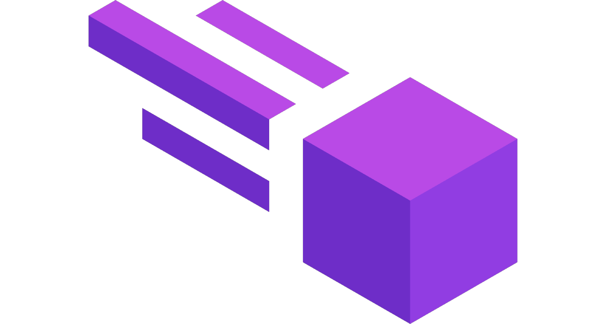

<h1 align="center">Meteor</h1>

A Minecraft Fabric Utility Mod for anarchy servers.

    
    

A fork of [meteor-client](https://github.com/MeteorDevelopment/meteor-client) for Minecraft 26.3 by [EvModder](https://github.com/EvModder). Not an official Meteor release. For usage and documentation, see the [upstream README](https://github.com/MeteorDevelopment/meteor-client#readme). Licensed under [GNU GPLv3](LICENSE), inherited from upstream.

## [↓ Download latest jar](https://github.com/EvModder/Meteor-EvFork/releases/download/latest/meteor-evfork-latest.jar)

## Changes in this fork

- **eBounce:** Updated Grim anticheat workaround; no longer pauses with the inventory open.
- **Kill Aura:** Optional pre-swing attacks reduce sprint-attack slowdown at the cost of attack damage.
- **ViaFabricPlus 5:** Supports optional VFP 5.1.1+; installing older versions will cause startup crashes.
- **Portals:** Keeps chat open and preserves unsent messages through nether portals.
- **GUI:** Corrects macOS Retina scaling on 26.3.
- **Iris compatibility:** Fixes tracer and ESP view bobbing with shaders.
- **Rendering stability:** Fixes an entity-outline crash and restores shader ESP/Chams rendering on 26.3.

Meteor maintainers: Feel free to DM me if you would like anything from here submitted upstream as a PR.

## License and credits

Meteor Client is copyright (c) Meteor Development. Original authors include MineGame159, squidoodly, and seasnail; see the [upstream contributors](https://github.com/MeteorDevelopment/meteor-client/graphs/contributors). Fork modifications are by EvModder and contributors, with dates and attribution recorded in the [commit history](https://github.com/EvModder/Meteor-EvFork/commits/master/).

- [Cabaletta](https://github.com/cabaletta) and [WagYourTail](https://github.com/wagyourtail) for [Baritone](https://github.com/cabaletta/baritone).
- The [Fabric Team](https://github.com/FabricMC) for [Fabric](https://github.com/FabricMC/fabric-loader) and [Yarn](https://github.com/FabricMC/yarn).
- Sophie for the [eBounce sprint-reset reference](https://github.com/sophimoo/ebonkfix/commit/8693f890d6b2b9f5d4a161367149b4a621d28be0).
- noramibu, Sophie, and Wide_Cat for the [Iris view-bobbing fix](https://github.com/MeteorDevelopment/meteor-client/pull/6175).
- MukjepScarlet, FabiFNA, and aazz180 for the [profile-import](https://github.com/MeteorDevelopment/meteor-client/pull/6435), [HUD rotation](https://github.com/MeteorDevelopment/meteor-client/pull/6514), and [AutoFish](https://github.com/MeteorDevelopment/meteor-client/pull/6316) fixes.

The fork remains free software under [GNU GPLv3](LICENSE), without warranty. Complete source and build scripts are available in [this repository](https://github.com/EvModder/Meteor-EvFork); release notes link to the exact source revision for each build. Build with Java 25 and `./gradlew build`. Bundled libraries remain under their respective licenses.
